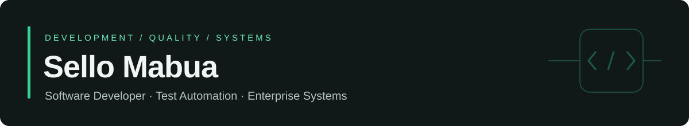

# Sello Mabua

**Software Developer · Test Automation · Enterprise Systems**  
Cape Town, South Africa

[Portfolio](https://sello-mabua-portfolio.vercel.app/) · [LinkedIn](https://www.linkedin.com/in/sello-mabua-137422128) · [Email](mailto:selloamos@gmail.com)

## About

I’m a software developer and learning technology specialist with over five years of experience in enterprise technology environments. My professional background spans Oracle Fusion Learning, LMS/CMS administration, responsive digital learning development, technical troubleshooting, quality assurance, data validation and requirements gathering.

Alongside my work at TFG, I build personal engineering projects in React and TypeScript, reusable UI components, automated testing and AI-assisted workflows. These projects extend my hands-on engineering practice and are separate from my employment experience.

## Professional Focus

- **Software and front-end development:** responsive applications, reusable components and interactive experiences.
- **Quality engineering:** functional, regression, end-to-end and API testing with maintainable test architecture.
- **Enterprise and workplace technology:** systems analysis, workflow configuration, technical support and auditable automation.

## Technical Skills

| Area | Technologies and practices |
| --- | --- |
| Software Development | JavaScript, TypeScript, React, Next.js, Node.js, Express, HTML5, CSS3, REST APIs |
| Testing & Quality Engineering | Playwright, Vitest, React Testing Library, Pester, regression testing, end-to-end and API testing, cross-browser checks |
| Front-End Engineering | Material UI, MUI X, Storybook, design tokens, responsive design, accessibility, Three.js, React Three Fiber |
| Enterprise Systems | Oracle Fusion Learning, LMS/CMS administration, Yoobic CMS, Airtable, Pyramid Data |
| Automation | PowerShell, workflow orchestration, AI-assisted classification, approval flows, audit logging |
| Developer Tools | Git, GitHub, GitHub Actions, Vite, automated build and test workflows |

## Featured Projects

Personal portfolio projects demonstrating implementation, testing and technical documentation.

### 01 · ShopSure
**QA Automation & Software Testing**

A UI and REST API test framework covering login, cart and checkout journeys against public demo services. Page objects, reusable test-data fixtures, HTML reports and requirements traceability support structured functional, regression and end-to-end coverage. GitHub Actions runs the suite; UI execution is configured for Chromium.

**Stack:** Playwright · TypeScript · GitHub Actions  
[Repository](https://github.com/Amos0323/ShopSure) · [Project preview](https://shop-sure-dexr.vercel.app)

### 02 · Nexa Design System
**Front-End Engineering & Design Systems**

Reusable enterprise UI components with typed React APIs, design tokens, MUI theming and MUI X data-grid/date-picker components. Storybook documents component use; Vitest, Testing Library and Playwright cover behavior, keyboard interaction and targeted accessibility checks. Includes a GitHub Actions quality workflow.

**Stack:** React · TypeScript · Material UI · MUI X · Storybook · Vitest · Playwright  
[Repository](https://github.com/Amos0323/nexa-design-system) · [Live demo](https://nexa-design-system-sello-m.vercel.app) · [Storybook](https://nexa-storybook-sello-m.vercel.app)

### 03 · MotionLab Interactive Design
**Interactive Front-End Development**

An interactive studio for kinetic typography, compatible-path SVG morphing, micro-interactions, scroll storytelling and a procedural 3D product experience. Reduced-motion controls, keyboard alternatives and a static WebGL fallback accompany responsive layouts. Vitest and Playwright cover interactions, with browser checks configured in GitHub Actions.

**Stack:** React · TypeScript · Motion · Three.js · React Three Fiber · Vitest · Playwright  
[Repository](https://github.com/Amos0323/motionlab-interactive-design) · [Live demo](https://motionlab-interactive-design-sello-m.vercel.app)

### 04 · FORMA Workspaces
**Web Development & Interactive Experiences**

A fictional workplace design studio combining responsive editorial pages with an interactive 3D showroom. Visitors can customise finishes and lighting, compare design snapshots and export design boards. Keyboard controls, static alternatives and on-demand 3D loading address accessibility and rendering cost; Vitest and Playwright provide unit and cross-browser test coverage.

**Stack:** Next.js · React · TypeScript · Three.js · React Three Fiber · GSAP · Vitest · Playwright  
[Repository](https://github.com/Amos0323/forma-workspaces) · Public source; hosted preview requires access.

### 05 · Employee Shuttle Tracker
**Application Development**

A mobile-first application with employee and driver/admin workflows, route maps, ETA displays and status updates. Shuttle movement is simulated; optional browser GPS and LocalStorage support same-browser demo updates, not a live fleet integration. Vitest covers demo authentication, distance calculations and service hours.

**Stack:** Next.js · React · TypeScript · Leaflet · Zod · Vitest  
[Repository](https://github.com/Amos0323/employee-shuttle-tracker) · [Live demo](https://employee-shuttle-tracker.vercel.app)

### 06 · Relay — AI Workflow Studio
**AI Automation & Workflow Engineering**

A visual workflow builder backed by a typed execution engine with branching, human approval, pause/resume and per-step audit logs. AI classification uses structured output validation and a deterministic fallback. External service adapters are explicitly simulated; Vitest tests classification fallback, conditions and mock integrations.

**Stack:** React · TypeScript · React Flow · Node.js · Express · Prisma · SQLite · OpenAI API · Vitest  
[Repository](https://github.com/Amos0323/ai-workflow-studio) · [Hosted interface](https://ai-workflow-studio-chi.vercel.app)

## Additional Projects

- **[Bookly AI](https://github.com/Amos0323/bookly-ai):** React/Express booking assistant with availability-aware responses, slot detection and a demo fallback.
- **[ReplyFlow AI](https://github.com/Amos0323/replyflow-ai):** React/Express lead-response prototype with reply drafts, interest/urgency classification and human approval.
- **[Remindly AI](https://github.com/Amos0323/remindly-ai):** Appointment calendar and reminder workflow with tested scheduling calculations and AI-assisted message drafts.
- **[Côte Noire Course Website](https://github.com/Amos0323/New2):** Astro/Tailwind learning experience with modular product content and interactive knowledge checks.
- **[Personal Portfolio Website](https://sello-mabua-portfolio.vercel.app/):** Project case studies, engineering focus and professional experience.

## Enterprise Automation — In Development

**WorkplaceOps Automation** is a local PowerShell project for simulated employee onboarding, transfers, offboarding and access governance. Its implementation includes request validation, dry-run plans, explicit approval checks, mock directory updates and audit records, with Pester tests for lifecycle and governance behavior.

It uses synthetic data and mock Microsoft Entra ID/Microsoft 365 operations. No live tenant integration is claimed; source is not currently public.

## Professional Experience

### Learning Technology Specialist · TFG — The Foschini Group

**April 2023–Present**

- Support Oracle Fusion Learning and configure LMS/CMS platforms and enterprise learning workflows.
- Troubleshoot platform issues, validate data and perform quality assurance on responsive learning experiences.
- Gather requirements with stakeholders and document configurations and support solutions.
- Use Pyramid Data and Airtable reporting to inform learning-content and platform decisions.

### Graduate Trainee — Front-End Developer · TFG — The Foschini Group

**April 2022–March 2023**

- Developed responsive digital learning materials using HTML, CSS, TypeScript and CMS tools.
- Debugged web experiences and tested browser compatibility and usability before release.
- Collaborated on requirements, LMS administration and learning-content delivery.

### Digital Learning Intern · TFG — The Foschini Group

**March 2021–March 2022**

- Created digital training and employee learning content in Yoobic CMS.
- Analysed learning analytics and training completion records against delivery requirements.
- Worked with stakeholders to identify training needs and report outcomes.

## Education

**Diploma in Information and Communications Technology**  
Cape Peninsula University of Technology · 2017–2020

**Higher Certificate in Information and Communication Technology**  
Cape Peninsula University of Technology · 2015–2016

## Engineering Approach

1. Understand the user journey, requirements and system constraints.
2. Build clear interfaces, reusable components and explicit workflow boundaries.
3. Verify behavior through appropriate tests, data checks and accessibility review.
4. Document implementation decisions, demo limitations and operational steps.

## Contact

Open to software and front-end development, QA automation, software testing, systems analysis, enterprise/workplace technology and AI automation opportunities.

[Portfolio](https://sello-mabua-portfolio.vercel.app/) · [LinkedIn](https://www.linkedin.com/in/sello-mabua-137422128) · [selloamos@gmail.com](mailto:selloamos@gmail.com)

